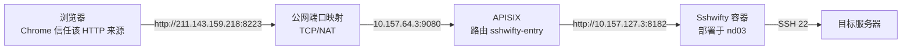

# Ubuntu 24.04：Sshwifty 部署与 APISIX 网关配置

Sshwifty 是浏览器端 SSH 客户端：浏览器连接 Sshwifty，由 Sshwifty 服务端再去连目标服务器的 SSH 服务。本文记录在 Ubuntu 24.04 上用 Docker 部署 Sshwifty，并复用已有 APISIX 网关以 `/ssh` 子路径对外暴露的做法，涵盖路径重写、WebSocket 放行，以及在不改网关协议的前提下让 Chrome 信任 HTTP 入口地址的处理方式。

> [!tip] 三条核心结论
> - 原版 Sshwifty 依赖浏览器 Web Crypto API，非安全上下文下登录必然报 `importKey` 错误。本次不改网关协议，直接用 Chrome 把 `http://211.143.159.218:8223` 认定为安全上下文。
> - Sshwifty 官方不推荐部署到共享域名的子路径。`/ssh` 只是入口，静态资源与接口仍占用同一来源的 `/sshwifty` 前缀，该前缀不能再分配给其他应用。
> - 浏览器信任例外只解决“加密 API 可用”，链路依旧是明文 HTTP；多人共用或链路不可信时应改用 HTTPS（第 10 节末）。

## 1. 用途与当前环境

本次部署涉及的地址与配置一览如下：

| 项目 | 本次环境 |
|---|---|
| 操作系统 | Ubuntu 24.04 |
| Sshwifty 部署主机 | 10.157.127.3（nd03） |
| Sshwifty 宿主机监听 | 0.0.0.0:8182，HTTP |
| APISIX 部署主机 | 10.157.64.3 |
| 公网已有映射 | 211.143.159.218:8223 → 10.157.64.3:9080 |
| 网页入口 | `/ssh`、`/ssh/` |
| APISIX 路由名称 | sshwifty-entry |
| 网页服务上游 | http://10.157.127.3:8182 |

链路可以概括为浏览器经公网映射进入 APISIX，再由 APISIX 反向代理到 nd03 上的 Sshwifty 容器：



图中 9080 全程保持 HTTP；浏览器侧的信任配置见第 10 节，缺了它登录会在前端加密环节失败。

两点容易误读的约定：

- `0.0.0.0` 表示监听所有 IPv4 网卡，不是用户应填写的访问地址。
- 本文 Ubuntu 安装命令按 root 用户执行，普通用户需在相应命令前加 sudo。不要在 Mac 上执行 Ubuntu 安装命令。

### 已验证与待完成事项

写作时明确区分实测结果和后续方案，避免把计划写成既成事实：

- 排查时已确认容器启动成功，Sshwifty 监听 8182。
- 原 APISIX 路由已合并入口、资源与后端接口路径，未要求新增 SSH 路由。
- 排查时页面、引用脚本返回 200；未提供入口密码时，认证查询返回 403 并带认证挑战。
- HTTP 登录出现 `importKey` 错误，尚不能视为终端功能验收通过。
- 第 10 节的浏览器信任配置属于后续操作方案，不代表已在访问端电脑落地。

## 2. 安装前提

动手前确认以下条件，缺一项都会在后续环节卡住：

- 通过其他设备或服务器控制台进入 10.157.127.3，具有安装权限。
- APISIX 所在网络可以访问 10.157.127.3:8182。
- Sshwifty 容器可以连接目标服务器的 SSH 端口。
- 访问端浏览器必须把入口地址视为安全上下文：本次通过在 Chrome 侧信任 `http://211.143.159.218:8223` 实现，否则只能改用 HTTPS。
- 8182 应只允许可信内网及 APISIX 访问。Docker 发布端口时，还需核实实际网络访问策略，不能仅根据 UFW 状态判断隔离是否生效。

## 3. 在 10.157.127.3 安装 Docker

```bash
apt update
apt install -y docker.io
systemctl enable --now docker
docker version
```

如果 Docker 已安装并正常工作，无需重复安装。

## 4. 拉取镜像

优先使用项目发布的镜像：

```bash
docker pull niruix/sshwifty:latest
```

中国大陆网络无法拉取时，可以尝试第三方“毫秒镜像”加速地址：

```bash
docker pull docker.1ms.run/niruix/sshwifty:latest
docker tag docker.1ms.run/niruix/sshwifty:latest niruix/sshwifty:latest
```

第三方加速源的可用性和缓存版本可能变化，不能保证始终可用。需要固定版本时，应记录验证过的标签或镜像摘要；不要在未验证时自动更新 latest。

### 离线导入备用方式

在能访问 Docker Hub 的另一台同架构 Linux 机器执行：

```bash
docker pull niruix/sshwifty:latest
docker save -o sshwifty.tar niruix/sshwifty:latest
```

把文件传到目标服务器后执行：

```bash
docker load -i sshwifty.tar
```

ARM Mac 上下载的默认镜像架构可能与 x86_64 服务器不同，不能直接假设可以通用。

## 5. 首次启动 Sshwifty

### 设置网页入口密码

以下密码是 Sshwifty 网页入口密码，与 APISIX 管理密钥、SSH 账号密码不同。不要把实际密码写入文档。

在 root 的 Bash 终端中执行，交互输入密码以避免把密码直接写入命令历史：

```bash
install -d -m 700 /etc/sshwifty
```

首次创建密码文件时会写入 `/etc/sshwifty/sshwifty.env`；如果文件已存在，脚本会退出并提示，不要直接覆盖已有的密码配置：

```bash
(
  set -e
  umask 077
  if [ -e /etc/sshwifty/sshwifty.env ]; then
    printf '密码文件已存在，请先检查，未覆盖。\n' >&2
    exit 1
  fi
  read -r -s -p '输入 Sshwifty 网页入口密码: ' sshwifty_pass
  printf '\n'
  if [ -z "$sshwifty_pass" ]; then
    printf '密码不能为空。\n' >&2
    exit 1
  fi
  printf 'SSHWIFTY_SHAREDKEY=%s\n' "$sshwifty_pass" > /etc/sshwifty/sshwifty.env
  unset sshwifty_pass
)
```

### 启动容器

先确认没有已有同名容器：

```bash
docker ps -a --filter name=sshwifty
```

仅首次部署时执行：

```bash
docker run -d \
  --name sshwifty \
  --restart unless-stopped \
  -p 0.0.0.0:8182:8182 \
  --add-host host.docker.internal:host-gateway \
  --env-file /etc/sshwifty/sshwifty.env \
  -e SSHWIFTY_LISTENINTERFACE=0.0.0.0 \
  -e SSHWIFTY_LISTENPORT=8182 \
  niruix/sshwifty:latest
```

已有容器正在运行时，不要为了照抄步骤删除重建。环境变量或 env 文件内容的变化不会通过简单的 `docker restart` 自动更新到已有容器；如需变更，应先记录当前启动配置，再在维护窗口按更新后的参数重建容器。

## 6. 验证 Sshwifty 服务

```bash
docker ps --filter name=sshwifty
docker logs --tail 50 sshwifty
curl -sS -o /dev/null -w 'HTTP %{http_code}\n' http://127.0.0.1:8182/
```

预期容器处于 Up 状态，日志出现：

```text
Server (0.0.0.0:8182): Serving
```

没有配置文件时，程序可能先记录“找不到默认配置文件”，再从环境变量加载配置。后续正常出现 Serving 时，这条警告本身不表示启动失败。

> [!warning] 不要用 `curl -I` 判断健康状态
> 它发送 HEAD 请求，本次部署对此返回 501，容易被误判为服务异常；应使用上面的 GET 请求检查。

## 7. APISIX：只维护一条现有路由

在 APISIX 的上游配置中使用：

| 配置项 | 值 |
|---|---|
| 名称 | sshwifty-upstream |
| 协议 | http |
| 节点 | 10.157.127.3 |
| 端口 | 8182 |
| 权重 | 1 |
| 负载均衡 | roundrobin |
| Host 传递 | pass |

编辑现有 `sshwifty-entry` 路由：

| 配置项 | 值 |
|---|---|
| 路径，分别添加四项 | `/ssh`、`/ssh/`、`/sshwifty`、`/sshwifty/*` |
| 上游 | sshwifty-upstream |
| 请求方法 | 不限制；界面必选时选择全部 |
| WebSocket | 开启 |
| 状态 | 启用 |
| Host 匹配 | 本次按 IP 访问，不新增与实际请求不符的域名限制 |

UI 中填写路径时不要输入反引号、引号或 Markdown 标记。曾经误填成带反引号的 `/ssh/`，导致路由无法匹配。

### 路径重写插件

在该路由的 `proxy-rewrite` 插件中使用：

```json
{
  "regex_uri": ["^/ssh/?$", "/"]
}
```

删除之前设置的固定 `uri: "/"`，不要同时保留；固定 uri 的优先级更高，会把资源和接口请求也重写成首页。

预期转发行为：

```text
/ssh                       → /
/ssh/                      → /
/sshwifty/assets/...       → /sshwifty/assets/...
/sshwifty/socket/verify    → /sshwifty/socket/verify
/sshwifty/socket           → /sshwifty/socket
```

Sshwifty 官方不推荐部署到共享域名子路径。本方案将 `/ssh` 作为入口，但其资源和接口仍占用同一来源的 `/sshwifty` 前缀，不能把所有请求都限制在 `/ssh` 下。该前缀不能分配给其他应用。

## 8. 验证网关与认证接口

在 APISIX 所在网络检查后端连通性：

```bash
curl --connect-timeout 5 -sS -o /dev/null \
  -w 'HTTP %{http_code}\n' http://10.157.127.3:8182/
```

用现有 HTTP 入口验证路由是否通；此时页面能打开，但在浏览器信任该来源之前仍无法完成登录：

```bash
curl -sS -o /dev/null -w 'HTTP %{http_code}\n' \
  http://211.143.159.218:8223/ssh/

curl -i http://211.143.159.218:8223/sshwifty/socket/verify
```

结果判读：

- 页面预期返回 200。
- 配置了入口密码时，首次无认证访问 verify 接口返回 403 并包含 `X-Key` 认证挑战属于正常情况。
- `404 Route Not Found` 表示应先检查网关路径、Host、方法和状态。
- `Unexpected backend query status: 404` 应重点检查 `/sshwifty/socket/verify` 是否被路由覆盖，以及是否被错误重写。

## 9. HTTP 入口的安全上下文限制

公网 HTTP 下登录会出现以下错误：

```text
Unable to authenticate:
TypeError: Cannot read properties of undefined (reading 'importKey')
```

问题不在 Sshwifty 服务端，也不在 APISIX：浏览器只在安全上下文（secure context）中暴露 Web Crypto API，普通 HTTP 页面上 `window.crypto.subtle` 是 `undefined`，前端加密入口密码时调用 `subtle.importKey` 就抛出这个异常。

由此可以得到三点判断：

- 这是浏览器侧限制，改密码、清空网页入口密码都不会生效。
- 原版 Sshwifty 没有通过启动参数关闭这项前端依赖的开关。
- 出路只有两条：让浏览器把当前 HTTP 地址认定为安全上下文（本次采用，见第 10 节），或真正部署 HTTPS。

链路本身仍然是 HTTP，`curl` 验证全部返回 200 也不代表能用：`curl` 不执行前端加密逻辑，只有真实浏览器才会暴露这个问题。

## 10. 用 Chrome 信任 HTTP 入口地址

思路是保留现有网关协议与公网映射，不改 APISIX 监听，只在使用端让 Chrome 把 `http://211.143.159.218:8223` 当作安全上下文，从而恢复 Web Crypto 等受限 API。

### 地址写法

- 必须写完整的来源（scheme + 主机 + 端口）：`http://211.143.159.218:8223`。
- 端口不同即不同来源；省略端口，或写成带 `/ssh/` 路径的形式，都可能匹配不上。
- 只对该来源生效，不影响 `javascript:`、其他 IP 和其他浏览器。

### 方式一：实验开关（单机临时测试）

1. Chrome 地址栏打开 `chrome://flags/#unsafely-treat-insecure-origin-as-secure`。
2. 该项选择 Enabled，在输入框填入 `http://211.143.159.218:8223`，多个来源用英文逗号分隔。
3. 点击 Relaunch 重启浏览器，再访问 `http://211.143.159.218:8223/ssh/`。

开关状态跟浏览器配置走，重置配置、重建用户目录或无痕窗口都可能失效，适合单人验证，不适合长期依赖。

### 方式二：企业策略（指定电脑长期可用）

对应的 Chromium 策略名为 `OverrideSecurityRestrictionsOnInsecureOrigin`（旧名 `UnsafelyTreatInsecureOriginAsSecure` 已在 M69 废弃），Chrome 69 及以上支持，写入后必须重启浏览器才生效：

macOS：

```bash
sudo defaults write '/Library/Managed Preferences/com.google.Chrome' \
  OverrideSecurityRestrictionsOnInsecureOrigin -array 'http://211.143.159.218:8223'
```

需要管理员权限。受管理的公司设备可能由 MDM 下发同名策略，手工写入会被覆盖，此时应向设备管理方申请。

Linux：

```bash
sudo install -d /etc/opt/chrome/policies/managed
sudo tee /etc/opt/chrome/policies/managed/sshwifty.json > /dev/null <<'JSON'
{
  "OverrideSecurityRestrictionsOnInsecureOrigin": [
    "http://211.143.159.218:8223"
  ]
}
JSON
```

Windows：在注册表 `HKLM\SOFTWARE\Policies\Google\Chrome\OverrideSecurityRestrictionsOnInsecureOrigin` 下依次新建字符串值 `1`、`2`……，内容为对应来源。

验证策略是否真正加载：

1. 打开 `chrome://policy`，确认列表中存在该项且状态为正常。
2. 若没有出现，点击页面上的“重新加载政策”，再完全退出并重启 Chrome。
3. 仍然不生效时确认写的是受管理路径，而不是普通用户偏好目录。

Edge 同为 Chromium 内核，策略名一致，但需按 Edge 自身文档确认下发路径。

### 方式三：临时命令行参数（不推荐分发）

```bash
open -a "Google Chrome" --args --unsafely-treat-insecure-origin-as-secure=http://211.143.159.218:8223
```

Chrome 已在运行时新参数不会生效，需先完全退出。此方式会让浏览器提示“正在使用不受支持的命令行标志”，且存在同名策略时策略优先级更高，只适合一次性排查。

### 验证是否生效

在页面按 F12 打开控制台执行：

```javascript
window.isSecureContext
```

返回 `true` 说明页面已被视为安全上下文。再确认加密能力可用：

```javascript
typeof window.crypto.subtle
```

返回 `"object"`；若为 `"undefined"`，说明信任尚未生效。两步都通过后刷新 `/ssh/`，重新输入入口密码，`importKey` 错误应当消失。

### 边界与代价

- 逐台生效：每台访问电脑、每个浏览器用户配置都要单独设置；换人、换机、换浏览器都得重做。
- 只是信任标记：链路仍是明文 HTTP，入口密码与 SSH 凭据在公网上可被嗅探，不能当成公网安全方案。
- 安全例外要有期限：记录申请人、用途和到期时间，用完移除策略并重启，避免长期保留绕过安全限制的配置。
- Chrome 的“一律使用安全连接”可能把该地址自动升级为 https 而打不开；用带 `http://` 的书签固定入口，或在站点设置里放行。
- Firefox、Safari 没有等价开关，只能用 HTTPS 访问。

### 备选：全员或长期使用时改用 HTTPS

访问设备多、人员流动大，或链路不完全可信时，应改为 HTTPS，而不是逐台配置浏览器：

- 公网端口必须是 TCP/NAT 转发；若公网侧是 HTTP 反向代理，只改内网协议无法改变公网入口。
- APISIX 上把 9080 改为 HTTPS、HTTP 移到 9081：`node_listen: 9081`、`ssl.enable: true`、`ssl.listen: 9080`、`fallback_sni: "211.143.159.218"`（参数名不是 `default_sni`，HTTP 与 HTTPS 不能同时占用 9080）。
- 证书可选公开 CA 签发的公网 IP 证书；用 mkcert 私有 CA 时，每台设备都要安装 `rootCA.pem`，且严禁分发 `rootCA-key.pem`。
- 切换后通过 8223 访问的其他应用与 UI 也要一并改用 HTTPS，需要提前评估影响面。
- 完成后移除 Chrome 侧的信任例外，避免留下两条并行入口。

## 11. 登录 SSH 与最终验收

在浏览器中先输入 Sshwifty 网页入口密码，再新增 SSH 连接并填写目标地址、端口、用户名和 SSH 凭据。

- 连接其他服务器：填写该服务器从 Sshwifty 容器可达的 IP 和 SSH 端口。
- 连接部署 Sshwifty 的宿主机：可填写 `host.docker.internal:22`，前提是按上述启动参数添加映射，且宿主机 SSH 监听对应接口、访问策略允许容器连接。
- 容器中的 `127.0.0.1` 指向容器自身，不是宿主机。
- 首次连接核对目标服务器的 SSH 主机密钥指纹。

最终验收应全部满足：

1. 入口页面在 Chrome 中打开，控制台 `window.isSecureContext` 为 `true`，地址栏不再标记“不安全”。
2. 页面脚本正常加载，入口密码认证成功，不再出现 `importKey` 错误。
3. WebSocket 连接建立，无接口 404。
4. SSH 登录成功，可以执行命令并持续显示输出。
5. 容器重启后服务仍可用；更换访问电脑时按第 10 节重新配置信任并通过验收。

## 12. 常见故障速查

| 现象 | 优先检查 |
|---|---|
| `curl -I /` 返回 501 | 改用 GET 请求验证，不据此认定容器故障 |
| 找不到默认配置文件 | 后续是否从环境变量加载并出现 Serving |
| `404 Route Not Found` | URI 是否有反引号、路由状态、Host 和方法限制 |
| 页面加载但后端查询 404 | 同一条路由是否包含 `/sshwifty/*`；是否错误保留固定重写 uri |
| 网页脚本请求得到 HTML | 资源被重写到首页，检查 proxy-rewrite |
| `importKey` undefined | 页面是否真是安全上下文：控制台看 `window.isSecureContext`、开关或策略是否写入并重启、是否换了浏览器配置或换了电脑 |
| `chrome://policy` 看不到策略 | 是否写入受管理路径、是否具备管理员权限、是否被 MDM 覆盖、是否重启过浏览器 |
| 地址被自动跳到 https 打不开 | Chrome 的“一律使用安全连接”或地址书写方式；改用带 `http://` 的书签 |
| verify 首次返回 403 | 若带认证挑战且设置了入口密码，这是正常认证流程 |
| 网关 502/504 | APISIX 到 10.157.127.3:8182 的网络、端口和服务状态 |
| 页面正常但终端断开 | WebSocket 开关、代理超时和服务端到目标 SSH 的连通性 |
| 时间差超限提示 | 浏览器电脑与服务器的时间同步；重载页面后复测 |

## 官方参考

- [Sshwifty 安装、环境变量与 FAQ](https://github.com/nirui/sshwifty)
- [Sshwifty Docker 镜像](https://hub.docker.com/r/niruix/sshwifty)
- [毫秒镜像加速说明](https://1ms.run/guide)
- [APISIX 路由、WebSocket 和 SSL API](https://apisix.apache.org/docs/apisix/admin-api/)
- [APISIX proxy-rewrite](https://apisix.apache.org/docs/apisix/plugins/proxy-rewrite/)
- [Chromium：不安全来源上的受限特性说明](https://www.chromium.org/Home/chromium-security/deprecating-powerful-features-on-insecure-origins/)
- [Chrome 企业策略 OverrideSecurityRestrictionsOnInsecureOrigin](https://chromeenterprise.google/policies/#OverrideSecurityRestrictionsOnInsecureOrigin)
- [MDN：安全上下文 Secure Contexts](https://developer.mozilla.org/en-US/docs/Web/Security/Secure_Contexts)
- [APISIX HTTPS 监听与 fallback_sni](https://apisix.apache.org/docs/apisix/FAQ/)
- [mkcert 安装与信任管理](https://github.com/FiloSottile/mkcert)
- [Let’s Encrypt IP 证书与 Certbot 支持](https://letsencrypt.org/2026/03/11/shorter-certs-certbot)
