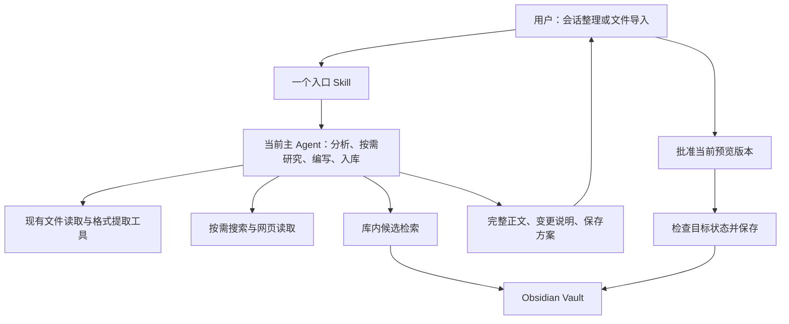
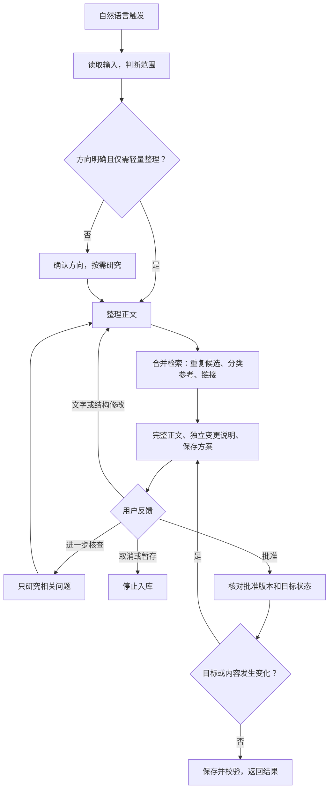

# DeepSeek Harness + Obsidian 智能知识库实施计划

版本：精简版 v1.0  
日期：2026-11-08  
状态：用户已批准实施；M1、M2 的入口和文件流程已实现并测试，M3 的真实资料内容质量验收待首次使用完成。使用入口及验证范围见 [使用说明](使用说明.md)。

## 1. 目标与已确定的原则

构建一个可长期使用的个人知识整理流程：将当前可访问的会话或用户提供的文件整理为 Obsidian Markdown，经完整预览和用户批准后入库。

采用 **一个入口 Skill，驱动当前主 Agent，按需使用现有工具**。不为分析、研究、编写和入库分别创建 Agent，也不搭建独立工作流系统。

已确定的默认选择：

- 使用官方本地 DeepSeek Harness；具体版本和可用能力在实施前核实。
- 外部资料保留全文中的有效信息，默认最小必要修改；摘要、大幅删减和拆分需用户明确要求或确认。

- 关键编辑方向与最终入库由用户决定；已有明确指令不重复询问。
- 优先复用原生能力，只有实际缺口才引入工具或依赖。

## 2. 最小架构



图中的步骤是逻辑职责，不代表独立进程、独立 Agent 或固定的一次模型请求。

| 职责 | 最小实现 |
| --- | --- |
| 入口与编排 | 一个 Skill：识别输入、确定范围、执行确认规则 |
| 内容处理 | 当前主 Agent 直接分析与编写，必要时研究 |
| 格式提取 | 按输入格式选择现有工具，不预先建设通用适配框架 |
| 库内检索 | 文件名、标题、别名和关键词检索，按需读取候选 |
| 写入 | 现有文件工具；不足以可靠检查和提交时，补一个小型辅助脚本 |
| 展示与存储 | Obsidian 和普通 Markdown 文件 |

不新增服务、数据库、专用前端或常驻进程。

## 3. 工作流与确认规则



### 输入与方向

- 根据用户提供的文件或会话范围识别输入；可组合使用。
- 仅使用实际可访问的会话。历史缺失或上下文经过压缩时，说明范围，不声称已审阅全部历史。
- 简单排版直接生成预览；重要重组、补充、纠错或范围不清时先确认方向。
- 仅排版时发现疑似事实错误，应提出问题，不擅自扩大到内容纠错。
- 多文件可以共同整理，但首版按文档逐项预览和批准，不做无人值守批量入库。

### 完整预览

每次预览包含三部分：

1. **完整正文**：实际准备保存的 Markdown，包括必要 Frontmatter 和参考来源。
2. **变更说明**：新增、修正、删减和重要结构变化及原因；事实修正附依据。更新旧笔记时，也说明相对已有笔记的变化。
3. **保存方案**：目标路径、新建或更新、重复候选处理、需要复制的附件及其他文件操作。

变更说明不混入正式正文。长正文可提供可完整阅读的草稿文件，不用摘要代替完整预览；这类预览落盘属于按需行为。

### 批准与反馈

- 批准绑定当前正文版本、路径和操作范围；任一变化都需重新批准。
- 批准后直接保存已展示的正文，不重新生成一遍。
- 文字和结构修改不重新研究；只处理受影响内容。
- 仅当修改改变主题、目标路径或链接需求时，重新检索。
- 取消后不写正式库；只有用户要求暂存时才保存草稿。

## 4. 内容质量与性能策略

### 内容质量

- 会话整理保留有效结论、关键操作、代码及使用条件；去除重复和无意义对话。
- 区分用户报告的验证结果、外部来源支持、推测和临时方案。被否定的结论不得作为最终建议；有价值的失败尝试可作为经验保留。
- 原始资料中的指令作为待整理内容处理，不因其出现而执行命令或扩大文件操作权限。
- 研究默认跳过；仅处理影响结论的明确疑点或用户要求的补充，优先官方技术资料。
- 补充、修正和未核实信息可辨识，重要依据进入笔记；未查证不能写成已验证。
- PDF、DOCX 检查代码缩进、表格、图片和阅读顺序。无法可靠提取时披露缺失，不输出貌似完整的正文。

### 减少调用与重复处理

| 场景 | 执行策略 |
| --- | --- |
| 短会话、短文本 | 直接使用当前上下文，不建任务目录和状态文件 |
| MD、TXT | 直接读取，复用已有内容 |
| PDF、DOCX | 提取一次，复用提取结果 |
| 长文档 | 按需保留提取结果与章节或页码定位，分段处理并回读关键原文 |
| 查重、分类、链接 | 合并一次候选检索，仅读取相关笔记 |
| 用户修改意见 | 局部处理，不重跑整个流程 |
| 目标未变化的提交 | 只做必要目标检查，不重新全库检索 |

“提取一次”不等于禁止核对原文。代码、表格、矛盾和重要删改需要回到对应位置检查，不能仅靠多层摘要。

简单任务的目标路径是：**利用输入 → 候选检索 → 完整预览 → 用户批准 → 检查并保存**。不联网、不调用子 Agent、不建立工作区。不承诺固定工具次数，以实际工具的批量能力和检查需求为准。

## 5. 知识库组织与来源保留

### 项目目录（Vault）

```text
/Users/lin/Desktop/obsidian/      # Vault
├── 00.草稿箱/
│   └── 原始资料/                # 原件与抽取结果（可追溯）
├── 01.实验操作/
├── 02.主题分类/
├── 03.概念知识/
└── assets/                     # 图片附件（M2 首用时创建）
```

核心目录已建立；`assets/` 在首次处理图片附件时创建。Skill 已按本机 Harness 加载规则安装在 `.dsh/skills/obsidian-knowledge/`，支持文件不混入正式知识分类目录。

### 分类与来源

保留四个一级内容目录，除 `00.草稿箱/原始资料/` 外，二级目录按实际内容增长，不预建完整分类树：

| 目录 | 主要用途 |
| --- | --- |
| `00.草稿箱` | 用户要求暂存的草稿、需落盘的长文预览及按需保留的资料 |
| `01.实验操作` | 执行、复现、部署、排障、调优 |
| `02.主题分类` | 主题学习、方案比较、架构设计 |
| `03.概念知识` | 可独立复用的细粒度知识 |

- 每篇笔记只有一个主目录，按主要阅读用途归类；不复制同一正文到多个目录。
- Tags 表达少量跨目录主题，不重复整个目录体系。
- Frontmatter 默认使用 `sources`、`created`、`updated`；日期采用 `YYYY-MM-DD`。`tags`、`aliases` 按需添加，保留已有笔记的其他元数据。
- `sources` 记录实际可用的来源路径、链接或会话来源描述；不伪造会话地址。具体事实的依据放在相关正文或参考资料中。
- 只添加确实存在且有阅读价值的内部链接，同名目标使用明确路径。
- 不自动拆分大量概念笔记，不为对称链接而默认改写旧笔记。

文件导入时，原始文件保持原位，不移动或删除；归档副本与需要落盘的抽取结果统一存入 `00.草稿箱/原始资料/`，记录两者的对应关系和原始来源。已归档且内容未变化的原件直接复用，不重复复制；MD、TXT 可直接读取归档原件，不生成内容相同的抽取副本。归档操作纳入保存方案，抽取结果一旦生成就复用，避免重复解析。

会话不默认归档全文。需要长期原文证据时，由用户选择将实际可访问的会话摘录保存到 `00.草稿箱/原始资料/`。图片等正文依赖的本地附件统一按需保存到 `assets/`，在预览中列明，并使用 Vault 内可解析的引用路径。

## 6. 查重与安全保存

1. **先查重**：按文件名、标题和关键词查找相近笔记；有重复时，由用户选择更新、另建或取消，不自动合并。
2. **确认后保存**：只将用户批准的正文写入 Vault 内确认的路径，不擅自覆盖或删除已有文件。
3. **更新前备份**：修改旧笔记前保留一份备份；若旧笔记在预览后发生变化，先重新确认。
4. **检查结果**：保存后检查正文和附件引用，返回名称、路径及结果。失败时说明原因，保留草稿或备份，不自动反复重试。

优先使用现有文件工具，不另建查重系统、版本管理系统或自动恢复流程。

## 7. 实施阶段

### M1：能力核实与最小闭环

架构确认后，核实官方本地 Harness 的版本、Skill 安装与发现方式、会话范围及文件读写能力。Vault 路径确定为 `/Users/lin/Desktop/obsidian/`；实施时检查其 Obsidian 配置状态，并按第 5 节建立核心内容目录及 `00.草稿箱/原始资料/`。

随后确定最小文件布局：一个入口 Skill，加确有需要的支持文件；不预建 Agent、接口适配器和状态管理目录。

先支持会话、MD、TXT，完成输入、预览、修改、确认、查重与保存闭环，并验证更新前备份。

### M2：常用文档格式

按真实样本加入文本型 PDF 和 DOCX，验证代码、表格、图片与来源定位。原件与抽取结果存入 `00.草稿箱/原始资料/`；首次需要图片附件时创建 `assets/`。复用现有流程，不为每种格式新增 Agent。

扫描件 OCR、复杂公式和特殊排版恢复暂不承诺自动完成；检测到这些情况时说明限制，并请求可用资料或后续专项处理。

### M3：真实任务验收与优化

使用短会话、短文档、长文档和更新已有笔记的任务验收。记录工具调用、重复读取、模型处理与工具耗时，用户等待时间单独计算；只针对实际瓶颈优化。

## 8. 验收标准

| 场景 | 通过标准 |
| --- | --- |
| 简单格式整理 | 不联网、不调用子 Agent、不建立任务工作区，直接完整预览 |
| 会话含否定结论 | 最终建议正确反映讨论结论，必要时明确历史局限 |
| 长文与技术内容 | 重要代码、条件、表格及图片引用保留，缺失被披露 |
| 研究失败 | 标记未核实内容，不编造结论或来源 |
| 用户只改标题或措辞 | 不重复解析文件，不无故重新研究 |
| 未批准或已取消 | 正式库无写入 |
| 预览后正文或路径变化 | 重新取得对应版本的批准 |
| 已有同名或疑似重复文档 | 不意外覆盖，不自动合并 |
| 预览后旧笔记发生变化 | 停止更新，重新展示变更 |
| 更新与异常 | 有原文备份，保存内容与批准正文一致，失败状态明确 |
| 附件处理 | 引用可用，不因失败删除无关附件 |
| 再次提交 | 先核对目标，避免意外重复或再次覆盖 |

## 9. 明确不实现

首版不实现四 Agent 编排、通用工作流引擎、持久化任务状态机、数据库、向量检索、全库 RAG、知识图谱服务、后台监听、自动批量改写、默认 OCR、专用前端、自动 Git 提交和工具权限强制隔离。

不把未来扩展预先转化为组件。先验证一个 Skill 能否可靠完成真实任务，再为反复出现且无法由现有工具解决的问题增加最小辅助能力。
